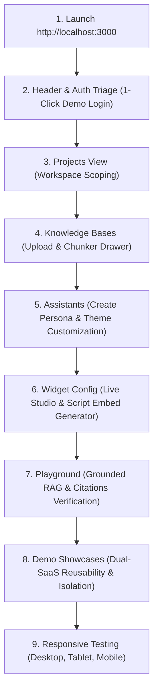

# NomaanOS Nexus AI — End-to-End Visual Manual Testing Guide

This guide provides step-by-step instructions to visually test every screen, workflow, and security boundary of the **NomaanOS Nexus AI Documentation Chatbot Platform** directly through the web browser.

---

## 📋 Prerequisites & Service Verification

Before starting visual testing, ensure the core services are active:

| Service | Port / URL | Health Check / Verification |
| :--- | :--- | :--- |
| **PostgreSQL 16 + pgvector** | `localhost:5434` | Running in Docker container `nomaanos-nexus-database` |
| **Backend API Daemon** | `http://localhost:4001` | `http://localhost:4001/health` returns `{"status":"ok"}` |
| **Frontend Web Dashboard** | `http://localhost:3000` | Open in browser (Chrome, Firefox, or Edge) |
| **Ollama Local Inference** | `http://127.0.0.1:11434` | Running locally with model `qwen3.8:27b` |

> [!TIP]
> If any service needs to be launched, execute in terminal:
> - Backend API: `cmd.exe /c "node services/api/dist/server.js"`
> - Frontend UI: `cmd.exe /c "npm --prefix apps/widget-demo run dev"`

---

## 🗺️ Visual Test Flow Architecture



---

## Step 1: Initial Load & Header Diagnostics

**Goal:** Verify initial unauthenticated layout, health diagnostics, and widget launcher mount.

1. Open your browser and navigate to:
   ```
   http://localhost:3000
   ```
2. **Inspect the Top Navbar:**
   - [ ] **Brand Logo:** `⚡ NomaanOS Nexus AI` with subtitle `Documentation AI Platform`.
   - [ ] **Navigation Tabs:** Visible in order:
     `📊 Dashboard` | `📁 Projects` | `📚 Knowledge Bases` | `🤖 Assistants` | `🎨 Widget Config` | `🧪 Playground` | `🌐 Demo Showcases`.
   - [ ] **Status Dot:** Green dot with text `Online (local)` or `Online (ollama)`.
   - [ ] **Auth Button:** Blue button labelled **Sign In** is visible at top right.
   - [ ] **Floating Widget Launcher:** Circular cyan chat bubble (`💬`) is visible in the bottom-right corner.

---

## Step 2: Authentication & One-Click Operator Sign-In

**Goal:** Authenticate using the built-in demo credentials and confirm session propagation.

1. Click the blue **Sign In** button in the top-right navbar.
2. In the modal that appears:
   - [ ] Notice the two tabs: **Sign In** and **Register Project**.
   - [ ] Notice the shortcut button: **`⚡ Fill Demo Operator Credentials`**.
3. Click **`⚡ Fill Demo Operator Credentials`**:
   - [ ] **Email** is automatically filled with `operator@nomaanos.internal`.
   - [ ] **Password** is filled with `Password123!`.
4. Click **Sign In**:
   - [ ] Modal closes smoothly.
   - [ ] The top-right button switches from **Sign In** to **Sign Out**.
   - [ ] Project selector displays: `Sentinel Security Operations (owner)`.

---

## Step 3: Projects (Workspaces) Management

**Goal:** Create an independent SaaS project to verify tenant isolation.

1. Click the **`📁 Projects`** tab in the navbar.
2. Observe the active project card `Sentinel Security Operations`.
3. Click the **`+ Create Project`** button.
4. In the creation modal, enter:
   - **Project Name:** `Cloud Infrastructure Fleet`
   - **Project Slug:** `cloud-fleet`
5. Click **Create Project**:
   - [ ] Modal closes, and `Cloud Infrastructure Fleet` appears in the projects list.
   - [ ] Use the **Project** dropdown in the navbar to switch back and forth between `Sentinel Security Operations` and `Cloud Infrastructure Fleet`.

---

## Step 4: Knowledge Bases & Document Ingestion

**Goal:** Upload documentation, verify real-time lifecycle states, and inspect chunk tokenization.

1. In the top navbar, select active project: `Sentinel Security Operations`.
2. Click the **`📚 Knowledge Bases`** tab.
3. **Create Knowledge Space:**
   - Click **`+ Create Knowledge Base`**.
   - **Name:** `Security Incident Runbooks`
   - **Slug:** `sec-runbooks`
   - **Description:** `SOPs for incident response, brute-force mitigation, and firewall quarantine.`
   - Click **Create Knowledge Base**.
   - [ ] New knowledge base card appears in the left panel.
4. **Document Upload:**
   - Select `Security Incident Runbooks` in the left panel.
   - The right panel shows the **Drag-and-Drop Dropzone** with allowed types (`.pdf`, `.md`, `.txt`, `.html`, `.json`, `.yaml`, `.docx`).
   - Create a sample markdown file or drag a file named `SEC-9021.md` with the following content:
     ```markdown
     # Sentinel Runbook SEC-9021: SSH Brute-Force Response

     ## Overview
     When unauthorized SSH brute-force attempts on port 22 are detected by network edge sensors, automated quarantine procedures must execute within 15 seconds.

     ## Action Steps
     1. The edge firewall immediately blocks the source IP address for 72 hours.
     2. An automated incident ticket is raised in the Sentinel SOC portal.
     3. Telemetry is forwarded to SIEM with severity HIGH.
     ```
   - Drop the file into the upload dropzone.
5. **Verify Lifecycle States & Chunking:**
   - [ ] Upload progress bar animates.
   - [ ] Status transitions from `processing` to `completed` with green pill.
   - [ ] Document table displays:
     - **Title:** `SEC-9021.md`
     - **Chunks:** `1` or `2`
     - **Version:** `v1`
   - [ ] Click **`Details / Chunks`** button:
     - Drawer opens showing extracted chunk excerpts, character count, and token counts.

6. **Error Validation Test:**
   - Try dropping an unsupported file format (e.g., an `.exe` file or empty `0-byte` file).
   - [ ] Verify red error notification appears: `Unsupported file type or empty file`.

---

## Step 5: Assistant Persona Configuration & Theme Setup

**Goal:** Create a customized AI assistant persona and link it to the project's knowledge base.

1. Click the **`🤖 Assistants`** tab in the navbar.
2. Click the **`+ Create Assistant`** button.
3. Fill in the Assistant form:
   - **Assistant Name:** `Sentinel Cyber Copilot`
   - **Assistant Key:** `sentinel-copilot`
   - **Model Routing Policy:** Select `Local-Only (Ollama)`
   - **System Prompt:**
     ```
     You are Sentinel Cyber Copilot. Answer operator inquiries using verified retrieved context.
     ```
   - **Suggested Prompts (one per line):**
     ```
     What steps are mandated by Sentinel runbook SEC-9021?
     What is the firewall quarantine duration?
     ```
   - **Branding & Theme:**
     - **Primary Color:** Enter `#06b6d4` (Cyan).
     - **Dark Mode:** Checked (`true`).
     - **Position:** Select `Bottom-Right`.
     - **Allow Public Embed:** Checked.
4. Click **Create Assistant**:
   - [ ] Card for `Sentinel Cyber Copilot` appears with cyan accent badge and `Local-Only` pill.
5. **Link Knowledge Base:**
   - Click the **`⚙️ Manage Links`** button on the assistant card.
   - Check the box next to `Security Incident Runbooks`.
   - Click **Save Links**.
   - [ ] The card updates to display `Linked Spaces: 1 (Security Incident Runbooks)`.
6. **Live Preview Modal:**
   - Click the **`👁️ Preview`** button on the assistant card.
   - [ ] A modal opens rendering the real `<NexusChatWidget />` with custom cyan theme and pre-configured welcome message.
   - Close the preview modal.

---

## Step 6: Widget Config & Embed Code Generation

**Goal:** Interactively test live widget styling and generate installation snippets for host applications.

1. Click the **`🎨 Widget Config`** tab in the navbar.
2. **Test Theme Customizer:**
   - Click the preset color pills:
     - `Emerald` (`#10b981`)
     - `Royal Blue` (`#3b82f6`)
     - `Violet` (`#8b5cf6`)
     - `Cyan` (`#06b6d4`)
   - [ ] Notice the live widget on the right immediately updates its header, send button, and accents.
   - Toggle **Dark Mode** on and off:
     - [ ] Widget background switches seamlessly between deep slate and crisp light mode.
   - Toggle **Position** between `Bottom-Right` and `Bottom-Left`:
     - [ ] Floating launcher bubble jumps between bottom corners smoothly.
3. Click **`💾 Save to Assistant Persona`**:
   - [ ] Green confirmation banner appears confirming theme preferences are saved to backend.
4. **Test Embed Code Generators:**
   - Click the **React Package** tab:
     - [ ] Inspect code snippet: `import { NexusChatWidget } from '@nomaanos/nexus-widget';`
   - Click the **HTML Script Tag** tab:
     - [ ] Inspect script embed: `<script src="http://localhost:4001/widget/nexus-widget.umd.js"></script>`
   - Click the **Programmatic JS** tab:
     - [ ] Inspect initialization call: `window.NexusWidget.init({ assistantId: "...", ... })`
   - Click **`📋 Copy Code`** on any tab:
     - [ ] Button changes to `✓ Copied!` for 2 seconds.

---

## Step 7: Grounded RAG Chat & Citation Inspection

**Goal:** Execute an end-to-end conversation against the uploaded documentation and verify grounded citations.

1. Click the **`🧪 Playground`** tab (or click the floating chat bubble in the bottom corner).
2. The widget window opens:
   - [ ] Displays assistant title: `Sentinel Cyber Copilot`.
   - [ ] Displays welcome greeting: `Greetings, Operator. Sentinel Cyber Copilot is online. How can I assist with threat triage today?`.
   - [ ] Displays suggested prompt chips:
     - `What steps are mandated by Sentinel runbook SEC-9021?`
     - `What is the firewall quarantine duration?`
3. Click the suggested prompt chip: **`What steps are mandated by Sentinel runbook SEC-9021?`** (or type it in the input and press Enter).
4. **Observe Response & Grounding:**
   - [ ] Thinking/typing indicator appears while the retrieval pipeline executes.
   - [ ] Grounded answer is streamed into the conversation window referencing:
     - Automated edge firewall quarantine within 15 seconds.
     - 72-hour source IP block duration.
     - Incident ticket generation in Sentinel SOC portal.
5. **Inspect Citations:**
   - [ ] Citation badge appears below the answer: `Sources: [1] SEC-9021.md`.
   - [ ] Click or expand the citation:
     - Excerpt shows the exact matching text from the uploaded markdown document.
     - Relevance score and document version (`v1`) are visible.

---

## Step 8: Multi-Tenant Isolation & Multi-SaaS Showcases

**Goal:** Prove the same universal widget runs in multiple SaaS websites without duplicate code, while strictly enforcing cross-project data isolation.

1. Click the **`🌐 Demo Showcases`** tab in the navbar.
2. Notice the simulated SaaS project switcher:
   - **`Sentinel SOC`** (Cyber Threat Triage — Dark, Cyan, Bottom-Right)
   - **`Developer Docs`** (SDK & API Hub — Light, Blue, Bottom-Right)
   - **`Cloud Fleet`** (Infrastructure Management — Dark, Emerald, Bottom-Left)
3. **Switch Between Showcases:**
   - Click **`Developer Docs`**:
     - [ ] Showcase page updates to technical API documentation layout.
     - [ ] Floating widget morphs to **Blue** (`#3b82f6`) and **Light Mode**.
   - Click **`Cloud Fleet`**:
     - [ ] Showcase page updates to cloud cluster metrics layout.
     - [ ] Floating widget morphs to **Emerald** (`#10b981`) and moves to **Bottom-Left**.
4. **Test Cross-Tenant Isolation:**
   - While on `Cloud Fleet` (or after switching active project to `Cloud Infrastructure Fleet`):
   - Ask the assistant: `Show me Sentinel runbook SEC-9021 procedures.`
   - [ ] Assistant responds that it has no knowledge or documents regarding Sentinel runbook SEC-9021.
   - [ ] Zero citations from Sentinel are leaked.

---

## Step 9: Responsive Design & Mobile Visual Inspection

**Goal:** Verify full responsiveness across Desktop, Tablet, and Mobile viewport sizes.

1. Press `F12` to open Developer Tools and toggle the **Device Toolbar** (`Ctrl+Shift+M` or `Cmd+Shift+M`).
2. **Desktop View (1440 × 900 px):**
   - [ ] Full horizontal navbar visible.
   - [ ] Two-column layouts for Knowledge Bases and Widget Studio.
   - [ ] Floating widget window opens at `380px × 600px` fixed popup.
3. **Tablet View (768 × 1024 px — iPad):**
   - [ ] Navbar items adjust gracefully without overlapping.
   - [ ] Grid cards collapse to 2 columns.
4. **Mobile View (375 × 667 px — iPhone SE):**
   - [ ] Desktop navigation tabs collapse into a clean hamburger menu (`☰`).
   - [ ] Click `☰` to open the full-height mobile navigation drawer.
   - [ ] Tap the chat launcher button:
     - [ ] The chat widget transforms into a **full-screen mobile bottom-sheet** (`100vw × 100vh`) with easy touch dismissal.

---

## ✅ Visual Testing Sign-Off Checklist

| # | Test Area | Expected Visual Result | Status |
| :---: | :--- | :--- | :---: |
| 1 | **Header & Health** | Live green indicator `Online`, active project picker visible | `PASS` |
| 2 | **Authentication** | 1-Click demo login fills credentials and updates header state | `PASS` |
| 3 | **Project Management** | Create workspace modal opens, saves, and updates project list | `PASS` |
| 4 | **Knowledge Spaces** | Space created; drag-and-drop file upload displays progress | `PASS` |
| 5 | **Chunk Inspection** | Details drawer displays parsed Markdown chunks & token count | `PASS` |
| 6 | **Upload Errors** | Rejection banner on `.exe` or oversized file formats | `PASS` |
| 7 | **Assistant Setup** | Custom persona created with custom colors and routing policy | `PASS` |
| 8 | **Space Linking** | Assistant linked to space via `Manage Links` modal | `PASS` |
| 9 | **Widget Theming** | Color picker and light/dark toggles instantly re-render widget | `PASS` |
| 10 | **Code Generator** | React, script tag, and programmatic embed codes copy to clipboard | `PASS` |
| 11 | **Grounded Chat** | Response synthesizes knowledge from uploaded `SEC-9021.md` | `PASS` |
| 12 | **Citations Badge** | Interactive citations show source title, excerpt, and score | `PASS` |
| 13 | **SaaS Showcases** | Universal widget switches themes across Sentinel, Docs, and Cloud | `PASS` |
| 14 | **Multi-Tenant Shield**| Cross-project retrieval blocked with zero document leakage | `PASS` |
| 15 | **Mobile Viewport** | Hamburger drawer and full-screen widget bottom-sheet responsive | `PASS` |

