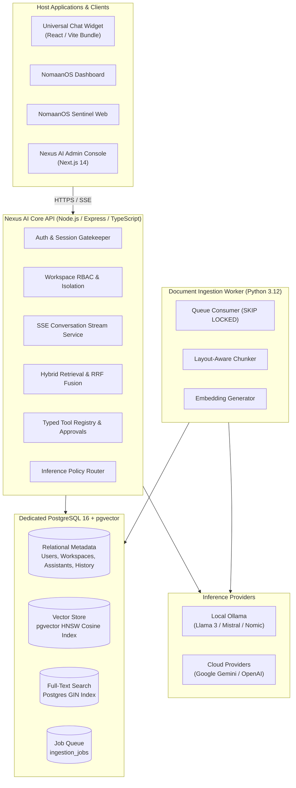

# NomaanOS Nexus AI

<div align="center">

**Unified, Multi-Tenant AI Assistant & Retrieval-Augmented Generation (RAG) Platform**  
*Powering intelligent conversational capabilities across the NomaanOS software ecosystem.*

[](https://www.typescriptlang.org/)
[](https://nodejs.org/)
[](https://github.com/pgvector/pgvector)
[](https://react.dev/)
[](https://nextjs.org/)
[](https://www.python.org/)
[]()

</div>

---

## 📖 Overview

**NomaanOS Nexus AI** is the central AI and knowledge intelligence backbone for the NomaanOS ecosystem. Built as a high-performance modular monolith with asynchronous background workers, Nexus AI provides a single, reusable AI backend powering multiple web applications and customer-facing interfaces—including **NomaanOS Sentinel** and the **NomaanOS Dashboard**—without requiring separate bespoke AI infrastructure for every product.

Nexus AI unifies semantic search, vector embeddings, keyword retrieval, and provider-independent LLM inference under a strict multi-tenant isolation model with verifiable citations and Human-in-the-Loop governance.

---

## ✨ Core Capabilities

- 🧩 **Universal Embeddable Widget**: Lightweight, responsive React and TypeScript chat widget distributed both as an npm package and a standalone embeddable script bundle.
- ⚡ **Real-Time Streaming**: Low-latency token, citation, and status streaming powered by HTTP Server-Sent Events (SSE).
- 🔍 **Hybrid Retrieval Engine**: Combines PostgreSQL full-text search (`tsvector` with GIN indexing) and vector semantic search (`pgvector` with HNSW cosine similarity) using Reciprocal Rank Fusion (RRF).
- 📚 **Document Ingestion Worker**: Out-of-band Python 3.12 background worker performing layout-aware chunking, content deduplication, and embedding generation across PDF, Markdown, TXT, HTML, and DOCX formats.
- 🛡️ **Evidence-Grounded Citations**: Responses are strictly anchored in retrieved context. Citations are verified against an allowlist before emission; missing evidence triggers honest abstention rather than hallucination.
- 🌐 **Flexible Inference Routing**: Per-assistant routing supporting `local-only` (Ollama), `cloud-preferred` (Google Gemini / OpenAI), `hybrid`, and `cloud-only` operational policies.
- 🔒 **Genuinely Offline-Capable**: Fully functional in air-gapped environments with bundled local weights, local embeddings (`nomic-embed-text`), local parsing, and zero external network calls.
- 🏢 **Multi-Tenant Isolation**: Two-tier organizational hierarchy (`Organization` -> `Workspace`) with creator ownership and hierarchical RBAC (`owner` > `admin` > `analyst` > `viewer`).
- 🤖 **Typed Tool Registry & Bounded Execution**: Agents operate with strictly validated JSON Schemas, hard execution budgets (max 5 steps), and mandatory Human-in-the-Loop approvals for mutating or consequential actions.
- 🎯 **Ecosystem Integration**: Seamless, loosely coupled integration with **NomaanOS Sentinel** for querying security events and drafting investigation cases.

---

## 🏛️ System Architecture



---

## 🚀 Quick Start & Local Environment

Follow the detailed [Local Development & Operations Guide](./docs/local-development-guide.md) for full setup instructions:

```bash
# 1. Copy local development environment variables
cp .env.example .env

# 2. Install workspace dependencies
npm install

# 3. Launch PostgreSQL 16 + pgvector container (port 5434)
npm run db:up

# 4. Run transactional database migrations
npm run db:migrate

# 5. Run the automated test suite
npm test

# 6. Start the API development server (http://localhost:4001)
npm run dev:api
```

Verify liveness and readiness:
```bash
curl http://localhost:4001/health
curl http://localhost:4001/ready
```

---

```
8-NomaanOS-Nexus-AI/
├── apps/
│   ├── admin/                    # Administrative Dashboard (Next.js 14, React 18, Tailwind)
│   └── widget-demo/              # Host application integration showcase
├── packages/
│   ├── shared-types/             # Canonical interfaces, event schemas, and contracts
│   └── widget/                   # Universal Chat Widget (Vite library & embeddable bundle)
├── services/
│   ├── api/                      # Nexus AI Core API (Express, TypeScript modular monolith)
│   └── ingestion-worker/         # Asynchronous document parsing and embedding worker (Python 3.12)
├── database/
│   ├── migrations/               # Transactional, version-tracked SQL migrations
│   └── schemas/                  # Canonical JSON Schemas (tools, events, configs)
├── docs/
│   ├── architecture/             # Complete Day 1 Architecture Specification Suite
│   │   ├── 01-repository-audit.md
│   │   ├── 02-system-architecture.md
│   │   ├── 03-api-contracts.md
│   │   ├── 04-data-model.md
│   │   ├── 05-threat-model.md
│   │   ├── 06-feature-test-matrix.md
│   │   ├── 07-first-e2e-acceptance-test.md
│   │   ├── 08-architecture-decisions.md
│   │   └── 09-day-2-handoff.md
│   ├── security/                 # Security, Authorization & Tenant Isolation Suite
│   │   └── 01-auth-tenant-isolation.md
│   └── local-development-guide.md
├── docker-compose.yml            # PostgreSQL 16 with pgvector & local services
├── package.json                  # Root npm workspace configuration
└── README.md                     # Platform overview and documentation
```

---

## 🗺️ Project Milestones & Roadmap

| Milestone | Stage | Key Focus Areas | Status |
|:---:|---|---|:---:|
| **Day 1** | **Architecture & Foundation Planning** | Repository audit, system design, API contracts, logical data model, threat model, ADRs, test matrix. | **Complete** |
| **Day 2** | **Core Database & API Foundation** | PostgreSQL + `pgvector` container, migrations runner, core data model, health probes, structured logging. | **Complete** |
| **Day 3** | **Auth, Authorization & Tenant Isolation** | Session auth, hierarchical RBAC (`owner` > `admin` > `analyst` > `viewer`), tenant scoping, AES-256 encrypted provider credentials, audit trail, rate limiting. | **Complete** |
| **Day 4** | **Universal Widget & Website Integration** | Reusable React chat widget package (`@nomaanos/nexus-widget`), standalone UMD embed script, dynamic theming, public/guest & authenticated assistant modes, zero client prompt tampering, multi-website showcase (`apps/widget-demo`). | **Complete** |
| **Day 5** | **Chat API, Streaming & Conversation History** | End-to-end chat flow, persistent history & pagination, SSE streaming (`text`, `citation`, `tool_status`, `completion`, `error`), client disconnect cancellation, message feedback & ratings (`message_feedback`), anonymous session isolation. | **Complete** |
| **Day 6** | **Document Ingestion & RAG Pipeline** | Python ingestion worker, structure-aware chunker, pgvector + FTS hybrid retrieval, verified citations. | Up Next |
| **Day 7** | **Admin Console & Production Hardening** | Next.js 14 administrative dashboard, evaluation benchmarks, air-gap validation, deployment. | Planned |

---

## 🔒 Security & Tenant Isolation Invariants

1. **Mandatory Workspace Scoping**: 100% of database queries must include `WHERE workspace_id = $1`. Cross-tenant data leakage is prevented at the database engine level.
2. **Zero Client Secrets**: Front-end widgets and client-side code never handle API keys, system prompts, or administrative configurations.
3. **Untrusted Evidence Boundary**: Content extracted from documents is treated as untrusted data and wrapped in explicit delimiters to prevent prompt injection.
4. **Mandatory Action Approvals**: Any tool that mutates state, deletes data, or executes consequential actions requires explicit human sign-off via an `ApprovalRequest`.
5. **Automated Secret Redaction**: Application logs automatically scrub passwords, bearer tokens, API keys, and session cookies via regex filters before emission.

---

## 📚 Architectural & Integration Documentation

Comprehensive architectural specifications and integration guides are maintained in the [`docs`](./docs/) directory:
- [Progressive Testing Guide (Day 6+)](./test.md) *(Step-by-step rebuild and test walkthrough starting from Day 6)*
- [Phase 1 Visual & Manual Testing Guide](./phase1-test.md) *(Full browser test walkthrough for Days 1-5)*
- [Knowledge Sources & Extraction Pipeline (Day 6)](./docs/knowledge-sources-and-extraction.md) *(Document ingestion & parser specs)*
- [Universal Chat Widget Integration Guide](./docs/widget-integration-guide.md)
- [Local Development & Operations Guide](./docs/local-development-guide.md)
- [Security & Authorization Architecture](./docs/security/01-auth-tenant-isolation.md)
- [Repository Audit & Ecosystem Evaluation](./docs/architecture/01-repository-audit.md)
- [System Architecture Specification](./docs/architecture/02-system-architecture.md)
- [Versioned API Contracts Draft](./docs/architecture/03-api-contracts.md)
- [Logical Data Model & Entity Specifications](./docs/architecture/04-data-model.md)
- [Security Threat Model & STRIDE Analysis](./docs/architecture/05-threat-model.md)
- [Feature-to-Test Matrix](./docs/architecture/06-feature-test-matrix.md)
- [First End-to-End Acceptance Test Specification](./docs/architecture/07-first-e2e-acceptance-test.md)
- [18 Architectural Decision Records (ADRs)](./docs/architecture/08-architecture-decisions.md)
- [Day 2 Implementation Handoff Guide](./docs/architecture/09-day-2-handoff.md)

---

## 👥 Authors & Team

Developed by the **NomaanOS Engineering Team** as a core shared intelligence platform for the NomaanOS product family.

