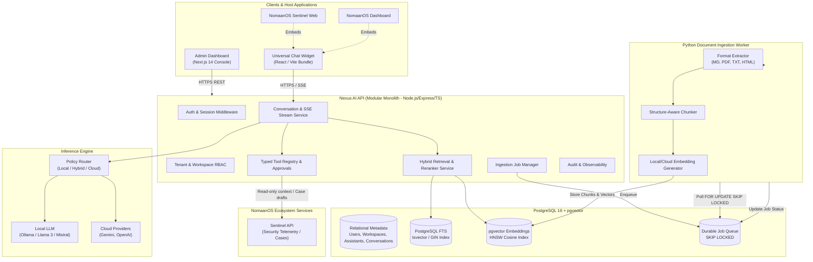
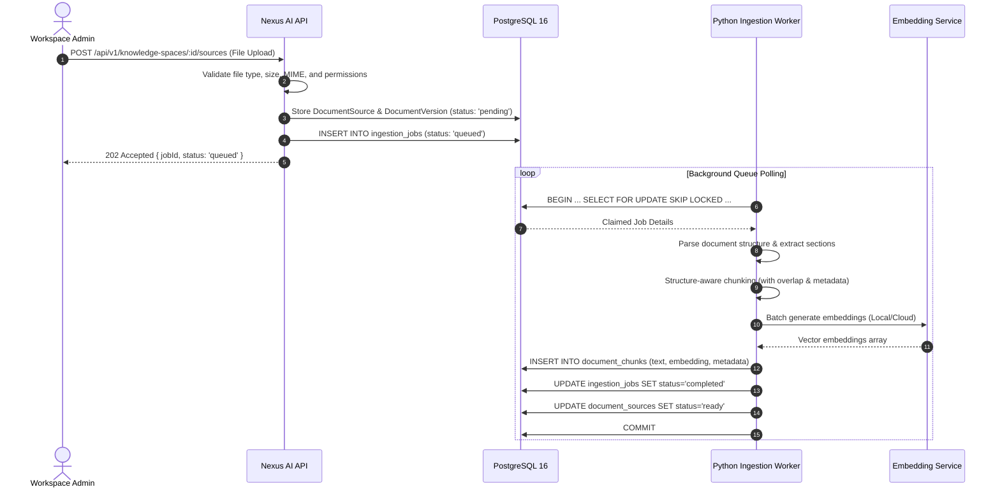
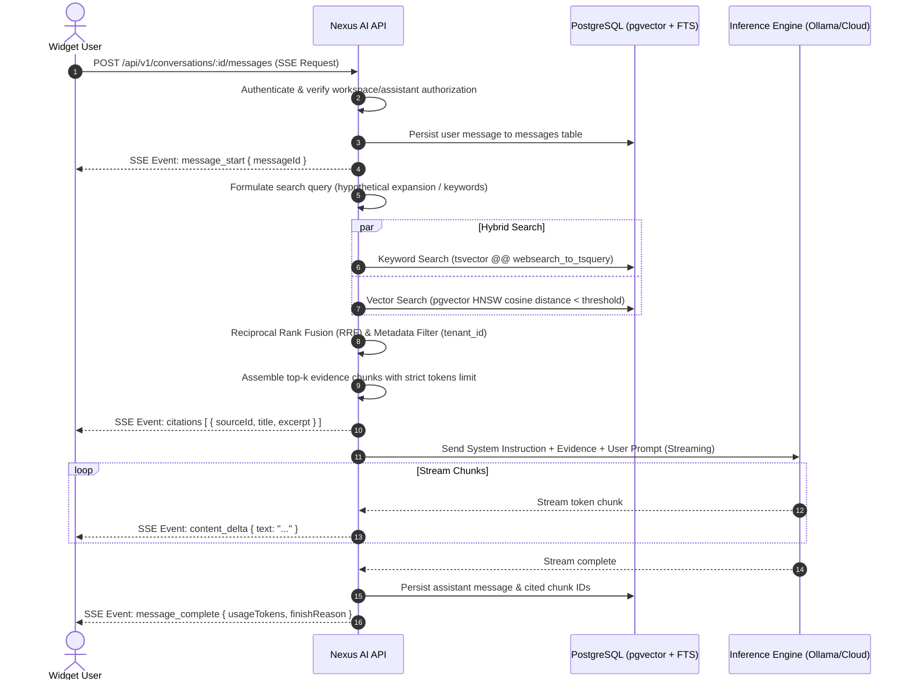

# Deliverable B: Nexus AI System Architecture Specification

## 1. Architectural Scope & Product Boundaries

NomaanOS Nexus AI is a unified, multi-tenant AI platform providing conversational intelligence, semantic knowledge retrieval (RAG), and bounded agent tool execution across the NomaanOS ecosystem.

### System Boundaries:
- **Client Boundary**: Universal React/TypeScript Chat Widget embeddable in web apps (Sentinel, Dashboard, external sites) and Admin Management Console.
- **API Boundary**: Express/TypeScript modular monolith enforcing tenant isolation, authentication, session security, rate limiting, and SSE streaming.
- **Worker Boundary**: Out-of-band Python worker handling heavy document extraction, layout analysis, chunking, and embedding generation via durable PostgreSQL job queues.
- **Storage Boundary**: PostgreSQL 16 with `pgvector` for relational metadata, full-text search, and vector embeddings.
- **Inference Boundary**: Provider-agnostic inference engine routing requests to local runtimes (Ollama) or external clouds (Gemini, OpenAI, Anthropic), with strict offline fail-safes.
- **Ecosystem Integration Boundary**: Versioned REST and adapter contracts integrating with NomaanOS Sentinel and NomaanOS Dashboard.



---

## 2. Logical Components and Responsibilities

### 2.1 Universal Chat Widget (`packages/widget`)
- **Technology**: React 18, TypeScript 5.8, bundled with Vite as an IIFE/UMD embeddable bundle and an npm package export.
- **Responsibilities**:
  - Load public assistant branding, avatar, theme tokens, and greeting via `GET /api/v1/assistants/:id/config`.
  - Maintain client conversation state with local resilience across page reloads.
  - Stream tokens, Markdown formatting, code blocks, and evidence citations in real-time via Server-Sent Events (SSE).
  - Surface interactive citation cards linking back to source titles and line/chunk excerpts.
  - Surface interactive Human-in-the-Loop approval requests for consequential actions.
  - Zero secret exposure: NEVER handles provider API keys, model parameters, or administrative configuration.

### 2.2 Administrative Dashboard (`apps/admin`)
- **Technology**: Next.js 14 (App Router), React 18, TypeScript, Tailwind CSS, Lucide React.
- **Responsibilities**:
  - Manage Organizations, Workspaces, and Assistant profiles.
  - Configure Knowledge Spaces, upload document sources, and monitor ingestion queues.
  - Configure Assistant inference policies (`local-only`, `cloud-preferred`, `hybrid`, `cloud-only`).
  - Configure Retrieval parameters (similarity threshold, top-k chunks, hybrid weights, reranking).
  - Inspect system audit logs, token usage records, and prompt evaluation benchmarks.
  - Strictly relies on API-enforced RBAC (`admin+` / `owner`).

### 2.3 Nexus AI Core API (`services/api`)
- **Technology**: Node.js 20+, Express 4.21, TypeScript 5.8, ESM architecture.
- **Design**: Modular monolith. Modules are logically partitioned with clean internal interfaces, sharing a single process initially to minimize operational overhead.
- **Internal Modules**:
  1. `Identity & RBAC`: Session validation, workspace scoping, permission checks.
  2. `Assistant Registry`: Assistant definitions, system prompts, model policies.
  3. `Conversation & Streaming`: SSE protocol, message history, cancellation handlers.
  4. `Knowledge Management`: Knowledge spaces, document source metadata, file upload handling.
  5. `Job Queue Coordinator`: Enqueuing ingestion jobs, tracking status, providing retry controls.
  6. `Hybrid Retrieval Engine`: PostgreSQL full-text search + pgvector similarity queries with Reciprocal Rank Fusion (RRF).
  7. `Inference Gateway`: Provider abstraction, timeout handling, circuit breakers, fallback policies.
  8. `Tool Registry & Agent Runner`: Typed tool validation, authorization boundaries, step budgeting.
  9. `Audit & Usage`: Token counting, duration logging, security event auditing.

### 2.4 Python Document Ingestion Worker (`services/ingestion-worker`)
- **Technology**: Python 3.12, Pytest, standard setuptools build.
- **Responsibilities**:
  - Durable job consumption using PostgreSQL `FOR UPDATE SKIP LOCKED`.
  - Format extractors: Markdown, Plain Text, HTML, PDF (via `pypdf`/`pdfplumber`), DOCX.
  - Structure-aware chunker: Respects markdown headers (`#`, `##`), paragraphs, and code blocks rather than arbitrary character splits.
  - Metadata attachment: Propagates `tenant_id`, `workspace_id`, `knowledge_space_id`, `source_id`, `document_version`, and document title to every chunk.
  - Content deduplication: Computes SHA-256 hashes of raw files and chunks to avoid redundant embedding generation.
  - Embedding generation: Interfaces with local embedding models (e.g. `nomic-embed-text` via Ollama) or cloud embedding models (Gemini/OpenAI).
  - Atomic persistence: Writes chunks and embeddings directly to PostgreSQL in transactions.

### 2.5 PostgreSQL & Knowledge Storage
- **Technology**: PostgreSQL 16 with `pgvector` extension.
- **Database Name**: `nomaanos_nexus_ai`.
- **Responsibilities**:
  - Relational metadata: Users, Workspaces, Assistants, Knowledge Spaces, Documents.
  - Ingestion Job Queue: `ingestion_jobs` with lease expiration and skip-locked queries.
  - Keyword Search: Standard PostgreSQL `tsvector` with `tsquery` and GIN indexing (`english` and simple configurations).
  - Vector Embeddings: `pgvector` column `vector(768)` or `vector(1536)` with `HNSW` index for cosine distance (`vector_cosine_ops`).
  - Chat persistence: `conversations`, `messages`, and `message_citations`.
  - Security audit records: `audit_events`, `tool_executions`, `approval_requests`.

---

## 3. Data Flow Specifications

### 3.1 Document Ingestion Flow


### 3.2 Chat & Retrieval Flow (RAG with Citations)


---

## 4. Inference & Offline Capabilities Model

Nexus AI supports four distinct inference policies configured per assistant:

| Policy | Primary Runtime | Fallback Runtime | Network Requirement | Use Case |
|---|---|---|---|---|
| `local-only` | Ollama (Local) | None (Fails if unavailable) | **Zero internet access** | Strict air-gapped deployments, sensitive defense/enterprise telemetry. |
| `cloud-preferred` | Cloud (Gemini / OpenAI) | Ollama (Local) | Internet preferred | High-quality generation with local business continuity during cloud outages. |
| `hybrid` | Local for embeddings & classification; Cloud for complex synthesis | Ollama (Local) | Partial internet | Optimized cost/performance trade-off with low latency embeddings. |
| `cloud-only` | Cloud (Gemini / OpenAI) | None | Internet required | Maximum reasoning capacity on commodity hardware with no local GPUs. |

### Genuine Offline Operation Requirements:
A deployment cannot be considered "offline-capable" simply by using a local LLM. Nexus AI guarantees genuine offline execution by packaging and bundling:
1. **Local LLM**: Ollama daemon hosting quantized models (e.g. `llama3.2:3b`, `qwen2.5:7b`).
2. **Local Embeddings**: Ollama or local sentence-transformers (e.g. `nomic-embed-text` with 768 dimensions).
3. **Local Vector Store**: PostgreSQL with `pgvector` running locally in Docker.
4. **Local Parsing**: Pure Python extractors (`pypdf`, `markdown`, `beautifulsoup4`) with zero external API dependencies.
5. **Local Widget Assets**: Self-hosted static JavaScript/CSS bundle served directly by the local API or host app.

---

## 5. NomaanOS Sentinel Integration Model

Nexus AI acts as an intelligent assistant layer for Sentinel without duplicating Sentinel's core domain models:

1. **Authentication Alignment**: Nexus AI honors Sentinel session cookies (`sentinel_session`) and matches Sentinel's workspace RBAC.
2. **Read-Only Telemetry Exploration**:
   - Nexus AI tools can query Sentinel's `GET /api/v1/workspaces/:id/events` and `GET /api/v1/workspaces/:id/cases/:caseId`.
   - Security events are sanitized using Sentinel's proven secret redaction patterns (`ai-evidence-sanitizer.ts`).
3. **Action Approval Boundary**:
   - Nexus AI **cannot** automatically mutate firewall rules, block IPs, or close investigation cases.
   - Any proposed remediation action triggers a typed `ApprovalRequest` requiring an analyst or admin with `analyst+` privileges to confirm in Sentinel.

---

## 6. Trust Boundaries & Security Perimeter

```
[ UNTRUSTED ZONE: Browser / Public Internet ]
           │
           ▼ (HTTPS / TLS 1.3 Termination, CORS, Rate Limiting)
[ PERIMETER BOUNDARY: Nexus AI API Gateway ]
  - Session verification & Token validation
  - Tenant ID extraction & cryptographic UUID assertion
  - JSON Schema input validation
           │
           ▼
[ TRUSTED ZONE: Internal Modular Monolith & PostgreSQL ]
  - Workspace-scoped database queries (WHERE workspace_id = $1)
  - Isolated database connections
           │
           ▼ (Internal UNIX socket / private Docker network)
[ WORKER ZONE: Python Ingestion Worker ]
  - Bounded memory, CPU, and execution timeouts
  - Isolated file parsing sandboxes
```

