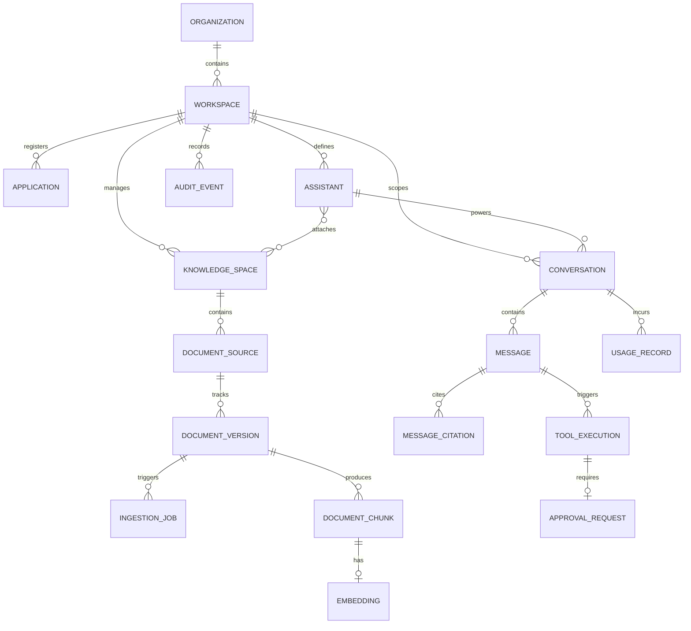

# Deliverable D: Logical Data Model & Entity Specifications

## 1. Overview & Data Architecture

Nexus AI adopts a clean, relational data model built on **PostgreSQL 16** with the **`pgvector`** extension. The schema enforces strict multi-tenant isolation, referential integrity via cascade rules, cryptographic UUID v4 identifiers, and comprehensive auditability.

---

## 2. Entity Specifications

### 2.1 Multi-Tenant Core Entities

#### 1. `Organization`
- **Purpose**: Top-level billing and enterprise administrative tenant boundary.
- **Primary Identifier**: `id UUID PRIMARY KEY DEFAULT gen_random_uuid()`
- **Owning Boundary**: Top-level root.
- **Relationships**: 1:N with `Workspace`.
- **Security & Access**: Restricts organization-level settings (`owner`, `admin`).
- **Retention & Deletion**: Soft deletion cascading to child workspaces after 30-day grace period.
- **Implementation Phase**: Milestone 1.

#### 2. `Workspace`
- **Purpose**: Operational tenant partition. All knowledge spaces, assistants, conversations, and documents belong strictly to a single workspace.
- **Primary Identifier**: `id UUID PRIMARY KEY DEFAULT gen_random_uuid()`
- **Owning Boundary**: `organization_id UUID REFERENCES organizations(id)`.
- **Relationships**: 1:N with `Assistant`, `KnowledgeSpace`, `Conversation`, `Application`.
- **Security & Access**: Hard tenant boundary. Every API query must filter `WHERE workspace_id = $1`.
- **Retention & Deletion**: Deletion cascades to all child assistants, knowledge spaces, and chat history.
- **Implementation Phase**: Milestone 1.

#### 3. `Application`
- **Purpose**: Represents an external client web application (e.g. `nomaanos-sentinel-web`, `nomaanos-dashboard`, external SaaS portal) authorized to embed Nexus AI assistants.
- **Primary Identifier**: `id UUID PRIMARY KEY DEFAULT gen_random_uuid()`
- **Owning Boundary**: `workspace_id UUID REFERENCES workspaces(id)`.
- **Relationships**: N:M with `Assistant`.
- **Security & Access**: Stores allowed origins (CORS) and public client tokens.
- **Retention & Deletion**: Deleting an application revokes its embed tokens.
- **Implementation Phase**: Milestone 2.

#### 4. `Assistant`
- **Purpose**: Autonomous agent or persona profile containing system instructions, temperature, model policy, attached knowledge spaces, and allowed tools.
- **Primary Identifier**: `id UUID PRIMARY KEY DEFAULT gen_random_uuid()`
- **Owning Boundary**: `workspace_id UUID REFERENCES workspaces(id)`.
- **Relationships**: Belongs to `Workspace`; attaches to 1:N `KnowledgeSpace` and 1:N `ToolDefinition`.
- **Security & Access**: System prompt and model credentials hidden from public widget.
- **Retention & Deletion**: Deletion archives past conversations or retains them in read-only state.
- **Implementation Phase**: Milestone 2.

---

### 2.2 Knowledge & RAG Entities

#### 5. `KnowledgeSpace`
- **Purpose**: Logical partition of domain documents (e.g., "SOC Runbooks", "Product Specs", "Compliance Policies").
- **Primary Identifier**: `id UUID PRIMARY KEY DEFAULT gen_random_uuid()`
- **Owning Boundary**: `workspace_id UUID REFERENCES workspaces(id)`.
- **Relationships**: 1:N with `DocumentSource`; attached to 1:N `Assistant`.
- **Security & Access**: Only assistants linked to this space may retrieve its chunks.
- **Retention & Deletion**: Cascade-deletes sources, chunks, and embeddings.
- **Implementation Phase**: Milestone 3.

#### 6. `DocumentSource`
- **Purpose**: Tracks a single uploaded document, external URL, or database sync source.
- **Primary Identifier**: `id UUID PRIMARY KEY DEFAULT gen_random_uuid()`
- **Owning Boundary**: `workspace_id UUID`, `knowledge_space_id UUID`.
- **Relationships**: 1:N with `DocumentVersion`.
- **Security & Access**: Carries file path, MIME type, and access-control flags.
- **Retention & Deletion**: Soft-delete marks record; background task purges file from disk.
- **Implementation Phase**: Milestone 3.

#### 7. `DocumentVersion`
- **Purpose**: Immutable snapshot of a source's content at a point in time, enabling incremental updates and version rollback.
- **Primary Identifier**: `id UUID PRIMARY KEY DEFAULT gen_random_uuid()`
- **Owning Boundary**: `source_id UUID REFERENCES document_sources(id)`.
- **Relationships**: 1:N with `DocumentChunk` and `IngestionJob`.
- **Security & Access**: Tracks SHA-256 content checksum for deduplication.
- **Retention & Deletion**: Retained for audit; old versions pruned when source is deleted.
- **Implementation Phase**: Milestone 3.

#### 8. `DocumentChunk`
- **Purpose**: Individual text chunk resulting from structure-aware document parsing.
- **Primary Identifier**: `id UUID PRIMARY KEY DEFAULT gen_random_uuid()`
- **Owning Boundary**: `workspace_id UUID`, `knowledge_space_id UUID`, `document_version_id UUID`.
- **Relationships**: 1:1 with `Embedding`.
- **Key Columns**: `chunk_index INT`, `content TEXT`, `token_count INT`, `metadata JSONB` (page numbers, section headers, line offsets), `tsv TSVECTOR GENERATED ALWAYS AS (to_tsvector('english', content)) STORED`.
- **Security & Access**: Inherits workspace ACL; GIN index on `tsv` for full-text search.
- **Retention & Deletion**: Hard deleted when parent document version is purged.
- **Implementation Phase**: Milestone 3.

#### 9. `Embedding`
- **Purpose**: High-dimensional vector representation of a chunk for semantic similarity search.
- **Primary Identifier**: `chunk_id UUID PRIMARY KEY REFERENCES document_chunks(id) ON DELETE CASCADE`
- **Owning Boundary**: Inherited from `DocumentChunk`.
- **Key Columns**: `embedding VECTOR(768)` (or `VECTOR(1536)`), `model_name VARCHAR(64)`.
- **Indexing**: `HNSW` index on `embedding vector_cosine_ops` (`m = 16, ef_construction = 64`).
- **Retention & Deletion**: Deleted atomically with chunk.
- **Implementation Phase**: Milestone 3.

#### 10. `IngestionJob`
- **Purpose**: Durable record for tracking asynchronous document processing tasks.
- **Primary Identifier**: `id UUID PRIMARY KEY DEFAULT gen_random_uuid()`
- **Owning Boundary**: `workspace_id UUID REFERENCES workspaces(id)`.
- **Relationships**: References `document_version_id UUID`.
- **Key Columns**: `status VARCHAR(32) CHECK (status IN ('queued','processing','completed','failed','cancelled'))`, `attempts INT DEFAULT 0`, `max_attempts INT DEFAULT 3`, `locked_at TIMESTAMPTZ`, `locked_by VARCHAR(64)`, `lease_expires_at TIMESTAMPTZ`, `last_error TEXT`.
- **Queue Semantics**: Claimed atomically via `FOR UPDATE SKIP LOCKED`.
- **Retention & Deletion**: Retained for 90 days for operational troubleshooting.
- **Implementation Phase**: Milestone 3.

---

### 2.3 Conversation & Execution Entities

#### 11. `Conversation`
- **Purpose**: Interactive conversation session between a user/guest and an assistant.
- **Primary Identifier**: `id UUID PRIMARY KEY DEFAULT gen_random_uuid()`
- **Owning Boundary**: `workspace_id UUID REFERENCES workspaces(id)`.
- **Relationships**: Belongs to `Assistant`; 1:N with `Message`.
- **Key Columns**: `created_by UUID NULL` (null for anonymous widget guests), `anonymous_session_token VARCHAR(64) NULL`, `title VARCHAR(255)`.
- **Security & Access**: User can only read conversations they created or have workspace viewer rights for.
- **Retention & Deletion**: Configurable retention (e.g. 30, 90, or 365 days).
- **Implementation Phase**: Milestone 2.

#### 12. `Message`
- **Purpose**: Single message in a conversation (`user`, `assistant`, `system`, `tool`).
- **Primary Identifier**: `id UUID PRIMARY KEY DEFAULT gen_random_uuid()`
- **Owning Boundary**: `conversation_id UUID REFERENCES conversations(id) ON DELETE CASCADE`.
- **Relationships**: 1:N with `MessageCitation` and `ToolExecution`.
- **Key Columns**: `role VARCHAR(16)`, `content TEXT`, `token_count INT`, `finish_reason VARCHAR(32)`.
- **Retention & Deletion**: Deleted with parent conversation.
- **Implementation Phase**: Milestone 2.

#### 13. `MessageCitation`
- **Purpose**: Provenance tracking tying an assistant response directly to the specific document chunks retrieved and referenced.
- **Primary Identifier**: `id UUID PRIMARY KEY DEFAULT gen_random_uuid()`
- **Relationships**: Links `message_id UUID` to `chunk_id UUID` and `source_id UUID`.
- **Key Columns**: `citation_index INT`, `excerpt TEXT`, `relevance_score FLOAT`.
- **Retention & Deletion**: Deleted with parent message.
- **Implementation Phase**: Milestone 2.

#### 14. `UserPreference` / `MemoryRecord`
- **Purpose**: Optional persistent user-specific preferences or memory facts across sessions.
- **Primary Identifier**: `id UUID PRIMARY KEY DEFAULT gen_random_uuid()`
- **Owning Boundary**: `workspace_id UUID`, `user_id UUID`.
- **Security & Access**: Strictly private to the owning user. Requires explicit user consent.
- **Retention & Deletion**: Immediate deletion upon user request (GDPR right-to-be-forgotten).
- **Implementation Phase**: Milestone 6 (Deferred to Advanced Phase).

---

### 2.4 Governance, Tool Execution & Observability Entities

#### 15. `ToolDefinition`
- **Purpose**: Registry of typed tools exposed to assistants with input/output JSON schemas and permission requirements.
- **Primary Identifier**: `id UUID PRIMARY KEY DEFAULT gen_random_uuid()`
- **Key Columns**: `name VARCHAR(64) UNIQUE`, `description TEXT`, `parameters_schema JSONB`, `requires_approval BOOLEAN DEFAULT FALSE`, `required_role VARCHAR(32) DEFAULT 'analyst'`.
- **Security & Access**: Tools cannot run without explicit permission check matching user's current session.
- **Implementation Phase**: Milestone 5.

#### 16. `ToolExecution`
- **Purpose**: Immutable audit log of a tool invoked by an assistant.
- **Primary Identifier**: `id UUID PRIMARY KEY DEFAULT gen_random_uuid()`
- **Owning Boundary**: `workspace_id UUID`, `message_id UUID`.
- **Key Columns**: `tool_name VARCHAR(64)`, `arguments JSONB`, `result JSONB`, `status VARCHAR(32)`, `duration_ms INT`.
- **Implementation Phase**: Milestone 5.

#### 17. `ApprovalRequest`
- **Purpose**: State machine record for Human-in-the-Loop review before executing high-impact actions.
- **Primary Identifier**: `id UUID PRIMARY KEY DEFAULT gen_random_uuid()`
- **Owning Boundary**: `workspace_id UUID`, `tool_execution_id UUID`.
- **Key Columns**: `status VARCHAR(32) CHECK (status IN ('pending', 'approved', 'rejected', 'expired'))`, `proposed_action TEXT`, `approver_user_id UUID`, `decided_at TIMESTAMPTZ`, `expires_at TIMESTAMPTZ`.
- **Security & Access**: Approver role must satisfy tool's required role.
- **Implementation Phase**: Milestone 5.

#### 18. `UsageRecord`
- **Purpose**: Aggregates token consumption, inference model usage, and latency for billing and quota enforcement.
- **Primary Identifier**: `id UUID PRIMARY KEY DEFAULT gen_random_uuid()`
- **Owning Boundary**: `workspace_id UUID`, `organization_id UUID`.
- **Key Columns**: `provider VARCHAR(64)`, `model VARCHAR(128)`, `prompt_tokens INT`, `completion_tokens INT`, `cost_cents INT`.
- **Implementation Phase**: Milestone 4.

#### 19. `AuditEvent`
- **Purpose**: Cryptographically verifiable security event log recording access changes, document uploads, tool executions, and security exceptions.
- **Primary Identifier**: `id UUID PRIMARY KEY DEFAULT gen_random_uuid()`
- **Owning Boundary**: `workspace_id UUID`.
- **Key Columns**: `actor_id UUID`, `action VARCHAR(64)`, `resource_type VARCHAR(64)`, `resource_id UUID`, `ip_address VARCHAR(45)`, `details JSONB`, `created_at TIMESTAMPTZ NOT NULL DEFAULT NOW()`.
- **Immutability**: Append-only. No `UPDATE` or `DELETE` grants in production.
- **Implementation Phase**: Milestone 1.

#### 20. `EvaluationRun`
- **Purpose**: Benchmark test suite execution record tracking RAG answer faithfulness, citation recall, latency, and hallucination rates against golden datasets.
- **Primary Identifier**: `id UUID PRIMARY KEY DEFAULT gen_random_uuid()`
- **Implementation Phase**: Milestone 6.

---

## 3. Entity Necessity Matrix (MVP vs Later Phases)

| Entity | First MVP (Day 2-3) | Core RAG (Day 4) | Tools & Approvals (Day 5) | Advanced & Scale (Day 6) |
|---|:---:|:---:|:---:|:---:|
| `Organization` | **Required** | - | - | - |
| `Workspace` | **Required** | - | - | - |
| `Assistant` | **Required** | - | - | - |
| `KnowledgeSpace` | **Required** | - | - | - |
| `DocumentSource` | **Required** | - | - | - |
| `DocumentVersion` | **Required** | - | - | - |
| `DocumentChunk` | **Required** | - | - | - |
| `Embedding` | **Required** | - | - | - |
| `IngestionJob` | **Required** | - | - | - |
| `Conversation` | **Required** | - | - | - |
| `Message` | **Required** | - | - | - |
| `MessageCitation` | **Required** | - | - | - |
| `AuditEvent` | **Required** | - | - | - |
| `Application` | - | **Required** | - | - |
| `UsageRecord` | - | **Required** | - | - |
| `ToolDefinition` | - | - | **Required** | - |
| `ToolExecution` | - | - | **Required** | - |
| `ApprovalRequest` | - | - | **Required** | - |
| `UserPreference` / `MemoryRecord` | - | - | - | **Deferred** |
| `EvaluationRun` | - | - | - | **Deferred** |

