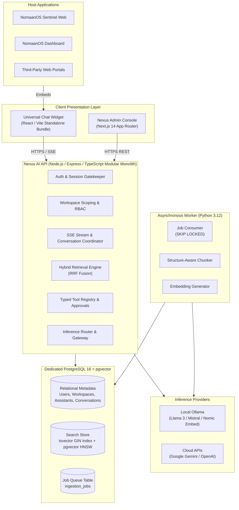

# NomaanOS Nexus AI — Architecture Documentation Suite

## 1. Executive Summary

**NomaanOS Nexus AI** is the unified, multi-tenant AI assistant and Retrieval-Augmented Generation (RAG) platform designed for the NomaanOS software ecosystem.

Rather than implementing fragmented, one-off AI integrations within each application (such as NomaanOS Sentinel or NomaanOS Dashboard), Nexus AI provides a centralized, modular platform delivering:
- A universal, embeddable React/TypeScript chat widget.
- Real-time token and citation streaming via Server-Sent Events (SSE).
- Multi-format document ingestion (PDF, Markdown, TXT, HTML, DOCX) via an asynchronous Python worker.
- Hybrid retrieval combining PostgreSQL full-text search and `pgvector` semantic similarity.
- Grounded generation with verifiable evidence citations and honest abstention on missing data.
- Flexible inference routing supporting local-only (Ollama), cloud-preferred (Gemini, OpenAI), hybrid, and cloud-only modes.
- True air-gapped, offline operational capability.
- Multi-tenant organization and workspace isolation with hierarchical RBAC.
- Typed tool execution with mandatory Human-in-the-Loop approvals for consequential actions.
- First-class, loosely coupled integration with NomaanOS Sentinel.

---

## 2. Documentation Deliverables Index

| Deliverable | Document Link | Description |
|---|---|---|
| **Deliverable A** | [Repository & Ecosystem Audit](./01-repository-audit.md) | Inspection of `6-NomaanOS-Sentinel`, `7-NomaanOS-Dashboard`, reusable components, and technology stack. |
| **Deliverable B** | [System Architecture Specification](./02-system-architecture.md) | Component boundaries, responsibilities, data flow diagrams, inference models, and trust boundaries. |
| **Deliverable C** | [Versioned API Contracts Draft](./03-api-contracts.md) | Initial API route specifications, SSE streaming protocol, payloads, and permissions. |
| **Deliverable D** | [Logical Data Model](./04-data-model.md) | Entity specifications, ER diagram, tenant ownership, indexing, retention, and migration strategy. |
| **Deliverable E** | [Security Threat Model](./05-threat-model.md) | STRIDE and OWASP LLM threat analysis, multi-tenant isolation, prompt injection defenses, and mitigations. |
| **Deliverable F** | [Feature-to-Test Matrix](./06-feature-test-matrix.md) | Complete roadmap of 42 platform features mapped to milestones, acceptance criteria, and test types. |
| **Deliverable G** | [First End-to-End Acceptance Test](./07-first-e2e-acceptance-test.md) | 15-step acceptance path from host embed to grounded RAG citation and cross-tenant verification. |
| **Deliverable H** | [Architectural Decision Records (ADRs)](./08-architecture-decisions.md) | 18 detailed ADRs covering deployment, database, queue, inference, streaming, and tool boundaries. |
| **Deliverable I** | [Day 2 Implementation Handoff](./09-day-2-handoff.md) | Exact instructions, tasks, and acceptance criteria for establishing the core foundation on Day 2. |
| **Operations** | [Local Development & Operations Guide](../local-development-guide.md) | Setup, startup, migrations, testing, and troubleshooting for the local environment. |

---

## 3. High-Level System Architecture Diagram

