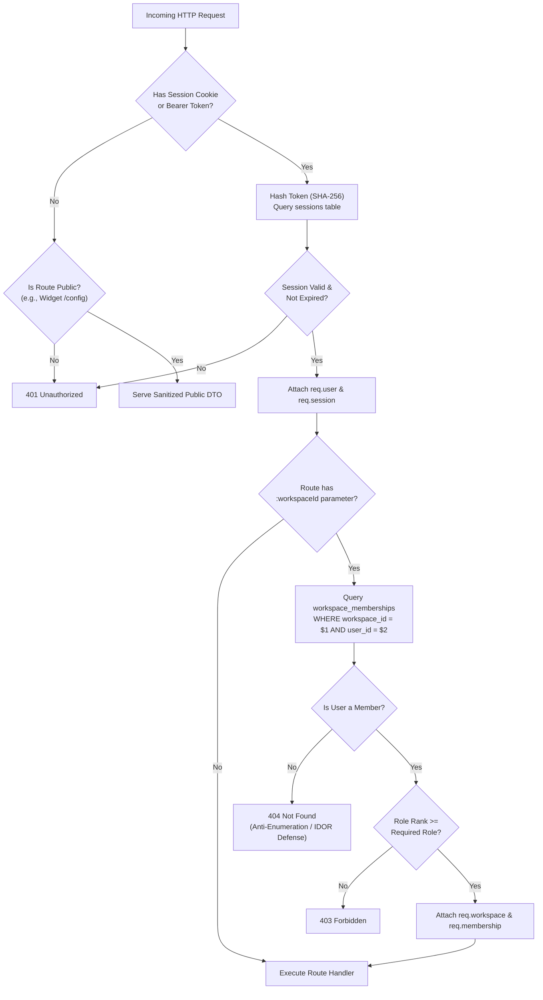

# NomaanOS Nexus AI — Authentication, Authorization, and Tenant Isolation Architecture

This document specifies the production security foundation implemented for NomaanOS Nexus AI in Day 3.

---

## 1. Security Architecture Overview

Nexus AI employs defense-in-depth security to guarantee strict tenant isolation across organizations, workspaces, applications, assistants, knowledge spaces, and provider credentials.



---

## 2. Server-Side Authentication & Session Management

- **Dual Authentication Vectors**:
  - **HttpOnly Cookie**: Standard browser clients store session tokens in `nexus_session` cookies configured with `HttpOnly: true`, `SameSite: Lax`, and `Path: /`.
  - **Authorization Bearer Header**: API consumers, mobile clients, and developer harnesses can supply tokens via `Authorization: Bearer <token>`.
- **High-Entropy Tokens**:
  - Generated using Node.js `crypto.randomBytes(32)` providing 256 bits of cryptographically secure entropy.
- **SHA-256 Token Storage**:
  - Tokens are never stored in plaintext in the database.
  - The database only persists `session_token_hash = SHA256(raw_token)`.
  - Stored tokens cannot be used to forge requests even in the event of an unauthorized database dump.
- **Constant-Time Verification**:
  - Token hashes are compared using `crypto.timingSafeEqual` where applicable to prevent timing attacks.
- **Session Revocation**:
  - Active sessions can be revoked individually on logout or globally across all devices (`revokeAllUserSessions`).

---

## 3. Multi-Tenant Isolation & Anti-Enumeration Defense

- **Workspace Scoping**:
  - Every operational entity (`applications`, `assistants`, `knowledge_spaces`, `provider_credentials`, `document_sources`, `conversations`) references `workspace_id UUID NOT NULL REFERENCES workspaces(id) ON DELETE CASCADE`.
- **Anti-Enumeration (404 vs 403)**:
  - If a caller attempts to access a workspace or workspace-scoped entity for which they do not possess active membership, the system responds with **`404 Not Found`** rather than `403 Forbidden`.
  - This prevents malicious actors from probing or enumerating valid workspace UUIDs across organizations.
- **Strict Query Scoping**:
  - All database queries enforce tenant isolation:
    ```sql
    SELECT * FROM assistants WHERE id = $1 AND workspace_id = $2;
    UPDATE knowledge_spaces SET name = $1 WHERE id = $2 AND workspace_id = $3;
    DELETE FROM provider_credentials WHERE id = $1 AND workspace_id = $2;
    ```
- **Cross-Tenant Association Protection**:
  - When associating resources (e.g., linking an assistant to an application or knowledge space), the system verifies in a single transaction that **both** entities belong to the caller's validated workspace.
  - Cross-workspace reference attempts are rejected immediately with 400 or 404 errors.

---

## 4. Hierarchical Role-Based Access Control (RBAC)

Membership within each workspace is strictly partitioned into four hierarchical roles:

| Role | Rank | Permissions |
|---|---|---|
| `owner` | 4 | Full workspace control, delete workspace, manage billing, assign owners, remove members. |
| `admin` | 3 | Manage workspace members (up to admin), configure provider credentials, delete applications/assistants/spaces. |
| `analyst` | 2 | Create, edit, and link assistants, applications, and knowledge spaces; trigger ingestion jobs. |
| `viewer` | 1 | Read-only access to assistants, spaces, and workspace metadata; query public and internal assistants. |

### Privilege Escalation & Invariant Protection
1. **No Self-Promotion**: A user cannot assign a role higher than their own privilege level.
2. **Sole-Owner Demotion Block**: The system blocks any attempt to demote or remove the sole `owner` of a workspace (`HTTP 400: Cannot demote/remove the sole owner of workspace`).
3. **Self-Modification Block**: Users cannot alter their own role within the workspace.

---

## 5. Encrypted Provider Credentials Storage

- **Algorithm**: `AES-256-GCM` (Galois/Counter Mode) authenticated encryption with authenticated integrity tags.
- **Key Derivation**: 32-byte master encryption key derived via SHA-256 from `SESSION_SECRET`.
- **Initialization Vector**: Unique, cryptographically random 12-byte IV generated per encryption event.
- **Ciphertext Format**: Hex-encoded composite string `IV:AuthTag:EncryptedData`.
- **Strict Masking**:
  - All read APIs (`GET /credentials`, `GET /credentials/:id`) return only masked fingerprints (`key_fingerprint = sk-...1234`).
  - Plaintext API keys and encrypted ciphertext are **never** returned by any API endpoint.

---

## 6. Security Audit Logging & Zero-Leakage Governance

- **Table**: `audit_events` (Append-only governance trail).
- **Tracked Actions**:
  - `user_registered`, `user_logged_in`, `user_logged_out`
  - `workspace_created`, `workspace_member_added`, `workspace_member_removed`, `workspace_member_role_updated`
  - `application_created`, `application_updated`, `application_deleted`
  - `assistant_created`, `assistant_updated`, `assistant_deleted`
  - `knowledge_space_created`, `knowledge_space_updated`, `knowledge_space_deleted`
  - `assistant_knowledge_space_linked`, `assistant_knowledge_space_unlinked`
  - `provider_credential_saved`, `provider_credential_deleted`
  - `unauthorized_cross_tenant_access_denied`
- **Zero-Secret Logging**:
  - All event details pass through recursive redaction (`sanitizeAuditDetails`).
  - Sensitive keys (`password`, `token`, `secret`, `apiKey`, `authorization`) are masked as `[REDACTED]`.
  - Structured pino logs redact sensitive tokens and credentials before emission.

---

## 7. Rate Limiting Protection

- In-memory sliding window rate limiter protects sensitive authentication and administrative endpoints:
  - `authRateLimiter`: 15 requests per minute per IP for `/register` and `/login`.
  - `sensitiveOpsRateLimiter`: 30 requests per minute per IP for credential operations.
- Violations respond with `HTTP 429 Too Many Requests` and standard `Retry-After` headers.

